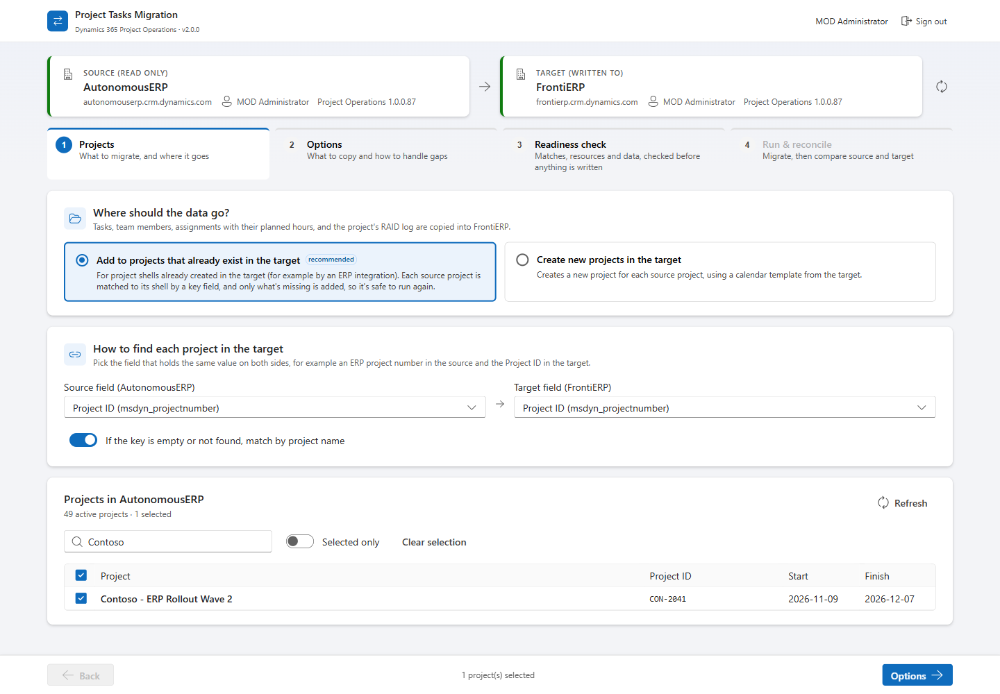
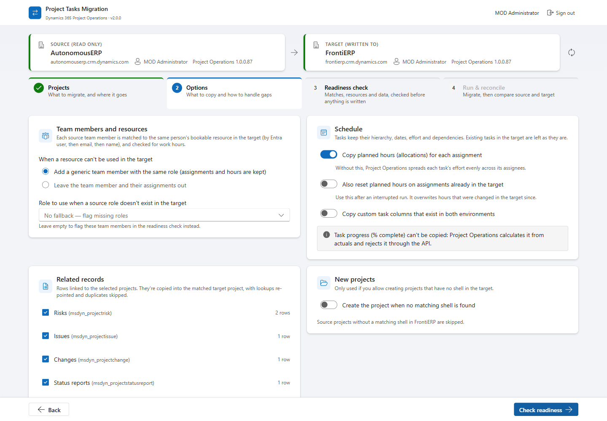
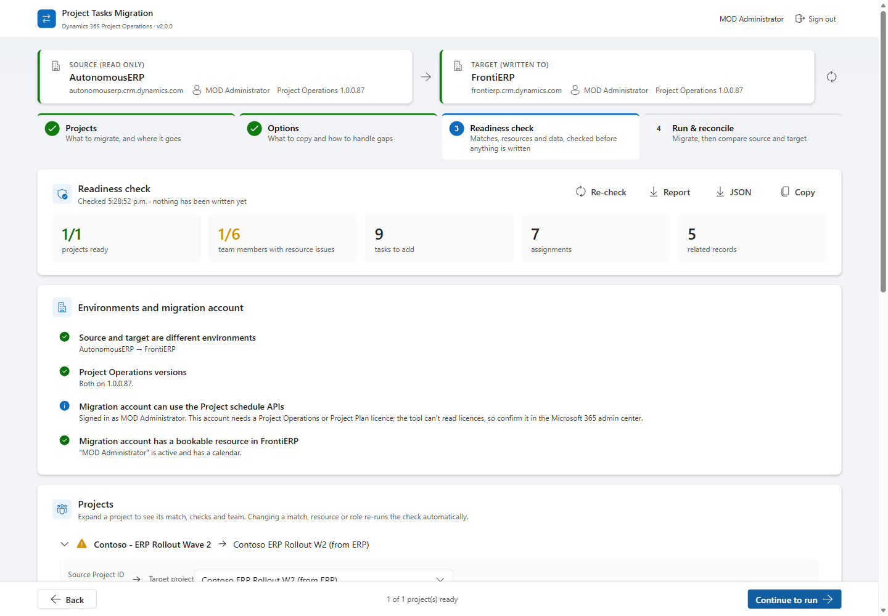
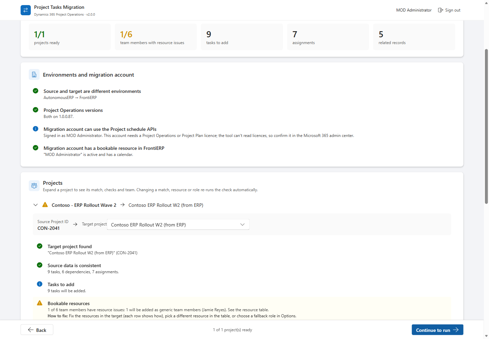
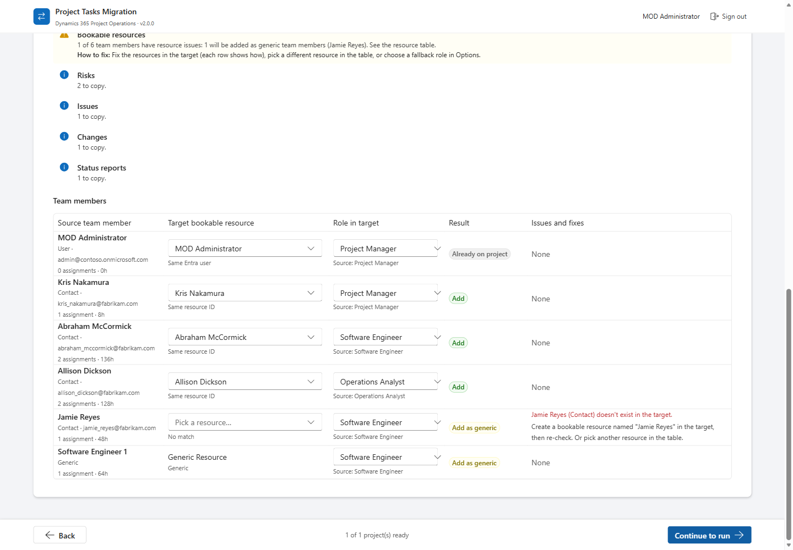
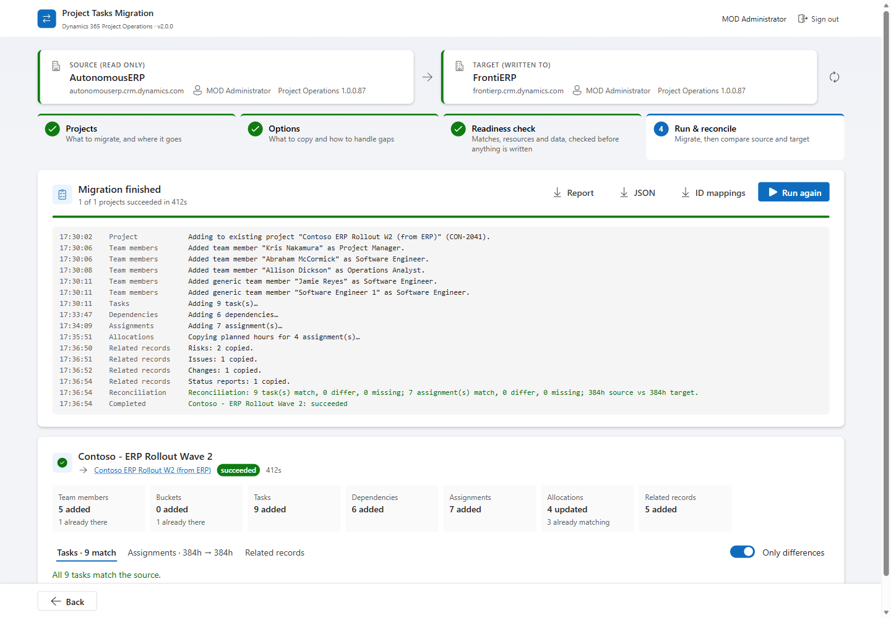
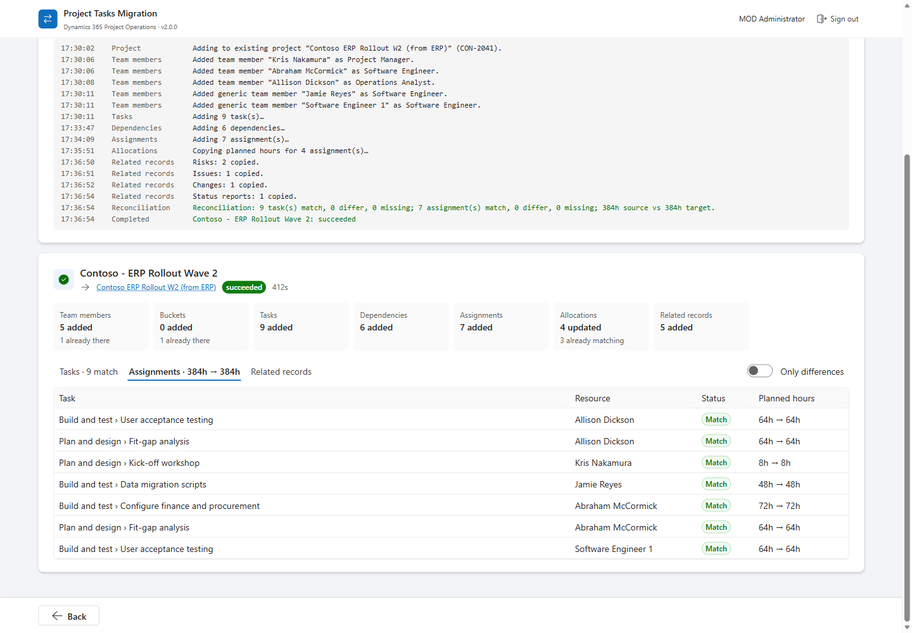

# Dynamics 365 Project Operations — Project Tasks Migration

A browser-based tool that moves **D365 Project Operations** project content between Dataverse environments:
- tasks, with their hierarchy, dates, effort and dependencies;
- team members, matched to the target's bookable resources;
- resource assignments with their **planned hours**;
- the project's **RAID log**: risks, issues, changes, status reports, notes, and custom tables linked to projects.

It's built with React, TypeScript and Fluent UI. It signs in with Microsoft Entra ID and writes through the Project schedule APIs, so the target's scheduling rules are applied.

> **Disclaimer**
> This project was vibe-coded by [@slimrouissi](https://github.com/slimrouissi) and is provided **as-is**, with **no guarantee, warranty, or support** of any kind. It is intended as an **example and reference implementation**. Version 2 of the web app was tested end to end between two Project Operations 1.0.0.87 demo environments (see [What's been tested](#whats-been-tested)). Test in a non-production environment first.

---

## What it does

| Step | What happens |
|---|---|
| **1. Projects** | Choose **Add to existing projects** (project shells already in the target, e.g. created by an ERP integration) or **Create new projects**. For existing projects, pick the key field on each side, e.g. source *ERP Project Number* → target *Project ID*. Select source projects. |
| **2. Options** | How to handle team members whose resource can't be used (generic team member with the same role, or leave out), a fallback role, whether to copy planned hours, and which related tables to copy. |
| **3. Readiness check** | Read-only. Checks the environments, the migration account, project matches, every bookable resource (exists, active, has work hours, role exists) and the source data. Each problem comes with the exact fix. You can pick a different target project, resource or role right in the tables. **Download the report** (Markdown or JSON) to share instead of screenshots. |
| **4. Run & reconcile** | Migrates, then compares source and target task by task (dates, effort) and assignment by assignment (hours), plus related-record counts. |

**Safe to run again.** Anything already in the target project (team members, tasks by their position in the hierarchy, dependencies, assignments, related records) is reused, not duplicated. If a run stops halfway, fix the cause and run again.

## Walkthrough

The screenshots below show a real run between two demo environments using fictional sample data: a source project *Contoso - ERP Rollout Wave 2* (Project ID `CON-2041`) is added to an empty project shell that an ERP integration had already created in the target with the same Project ID.

**1. Choose where the data goes and how to find each project.** Pick *Add to projects that already exist in the target*, then the field that holds the same value on both sides (here *Project ID* → *Project ID*; it can be any column, such as a custom ERP project number). Select the projects to migrate.



**2. Options.** Decide what happens when a person's bookable resource can't be used in the target, whether to copy planned hours, and which related tables to bring across (risks, issues, changes, status reports and any custom table linked to the project).



**3. Readiness check (read-only).** Nothing is written yet. The tool checks both environments and the migration account, including that the account has a bookable resource with work hours in the target, and summarises what will be added. Use **Report** to download it and share it instead of screenshots.



Each project shows the target shell it matched (you can pick another one) and its checks.



Every team member is matched to a bookable resource in the target and checked. In this example *Jamie Reyes* doesn't exist in the target, so the row says exactly what to do: create the resource and re-check, pick another resource in the dropdown, or let the tool add a generic team member with the same role.



**4. Run.** The log shows each stage: team members, tasks, dependencies, assignments, planned hours and related records. Project Operations processes schedule changes in the background, so a stage can take a few minutes on a busy environment; the log shows when the tool is still waiting.



**5. Reconcile.** After the run the tool compares source and target task by task and assignment by assignment. Here all 9 tasks match and all 7 assignments carry the same planned hours (384h → 384h). Download the report or the ID mappings for your records.



### How resources are matched

For each source team member, the tool looks for the target bookable resource in this order:

1. a resource you picked in the readiness table;
2. the same bookable resource ID (environments copied from one another keep IDs);
3. the same Entra user (stable across environments in one tenant);
4. the same email;
5. the same name, if it's unique.

Generic team members map to the target's generic resource and keep their role. Each matched resource is checked: active, linked user enabled, and its calendar (work hours) exists.

### What isn't copied

- **Task progress (% complete).** Project Operations calculates it from actuals and rejects it through the schedule APIs ("Input to the column msdyn_progress … is not allowed").
- **Actuals, time entries, expenses, estimates, budgets, bookings.** These are financial or transactional records with their own processes.
- **Tables that link two projects** (e.g. cross-project dependencies).

## Prerequisites

- **Node.js** 18+ and npm.
- An **Entra ID app registration**:
  - platform **Single-page application** with redirect URI `http://localhost:3000`, or the port you use;
  - delegated permission **Dynamics CRM → user_impersonation**, with admin consent.
- A **named user account** (not an application user) that:
  - is a user in **both** environments, i.e. is in each environment's security group if one is set;
  - has a **Project Operations or Project Plan licence**, since only licensed users can call the schedule APIs;
  - has read access in the source and Project Manager-level write access in the target;
  - has a **bookable resource with work hours in the target**. This is needed when creating projects, because Project Operations makes the creator the project manager.
- **Create mode only:** an active **calendar template** with work hours in the target (see [Troubleshooting](#troubleshooting)).

## Getting started

```bash
git clone https://github.com/slimrouissi/ProjectTasksMigration.git
cd ProjectTasksMigration
npm install
cp .env.example .env      # then fill in the four values
npm run dev               # http://localhost:3000
```

```env
VITE_CLIENT_ID=<Application (client) ID of the app registration>
VITE_TENANT_ID=<Directory (tenant) ID>
VITE_SOURCE_URL=https://<source-org>.crm.dynamics.com
VITE_TARGET_URL=https://<target-org>.crm.dynamics.com
```

After sign-in, the header shows each environment's **friendly name**, URL, signed-in user and Project Operations version. Check you're pointing at the right ones (e.g. Test vs Prod) before you go further.

### Headless run (optional)

The same engine runs from the command line using `az login` tokens. This is useful for testing or for large batches:

```bash
az login --tenant <tenant-id>
npx vite-node scripts/migrate-cli.ts -- \
  --source https://<source>.crm.dynamics.com --target https://<target>.crm.dynamics.com \
  --project "<source project name or ID>|<another>" \
  --key <source key field> --target-key msdyn_projectnumber \
  --related msdyn_projectrisk,msdyn_projectissue,msdyn_projectchange,msdyn_projectstatusreport \
  --fallback-role "Team Member" --out report.json   # add --plan-only for the readiness check only
```

## Troubleshooting

| Message | Cause | Fix |
|---|---|---|
| **HTTP 403 … 0x80072560 "The user is not a member of the organization"** | The signed-in account isn't a user of that environment, usually because the environment has a **security group** (an Entra group) and the account isn't a direct member. | Add the account **directly** to the environment's Entra security group (nested groups aren't enough), or add it in Power Platform admin center → Environments → *env* → Settings → Users. |
| **AADSTS9002326 "Cross-origin token redemption is permitted only for the 'Single-Page Application' client-type"** | The app registration's redirect URI is registered as Web, not SPA. | Add the redirect URI under the **Single-page application** platform. |
| **"The calendar for the specified work hour template cannot be found" (0x80040265)** | Create mode only. The target's calendar template points to a calendar that doesn't exist there (often a template imported from another environment), or the migration account's bookable resource has no calendar. | Use **Add to existing projects** if the shells already exist. Otherwise, in the target go to Settings > Calendar Templates > New, select a Template Resource with work hours (or set hours on the Calendar tab), and pick it in Options. Also make sure the migration account has a bookable resource with work hours. |
| **"No working hours between start and end dates"** | Planned hours fall on days that aren't working days in the target calendar. | Handled automatically: hours are moved to the target's working days and total effort is kept. The run lists how many hours were moved. |
| A resource shows **"user in the target but has no bookable resource"** | The person exists in the target but isn't set up as a bookable resource. | Target → Resources → Resources → New, select the user, set Work Hours, save. Then re-check. |
| A role shows **"doesn't exist in the target"** | The resource role (category) wasn't created in the target. | Create it under Resources → Resource Roles, pick another role in the table, or set a fallback role in Options. |

Use **Report** (readiness or results) to share everything in one file: environments, settings, every check, the resource table, results and any failed requests.

## Architecture

```
src/
├── auth/                   MSAL sign-in and per-environment tokens
├── clients/
│   ├── DataverseClient     Web API client: paging, retries on throttling, request log
│   └── ScheduleApiClient   CreateProjectV1, CreateTeamMemberV1, OperationSets (PssCreateV2,
│                           PssUpdateV1, PssUpdateResourceAssignmentContourV1), error-log lookup
├── services/
│   ├── EnvironmentService  Friendly name, versions, migration account checks
│   ├── MetadataService     Key fields, related tables, column schema for generic copy
│   ├── SourceService       Reads projects and everything linked to them
│   ├── ProjectMatchService Source project → existing target project (key field, name fallback, manual)
│   ├── ResourceService     Bookable resource and role matching + validation
│   ├── TargetStateService  What already exists in a target project (for re-runs)
│   ├── TargetCalendarService  Calendar templates (create mode)
│   ├── MigrationPlanner    Readiness check (read-only)
│   ├── MigrationEngine     Executes the plan, stage by stage, idempotently
│   ├── RelatedRecordService  Generic copy of RAID/status/custom tables with lookup re-pointing
│   ├── ReconciliationService Source vs target comparison
│   ├── ValidationService   Source data checks
│   └── DiagnosticsService  Downloadable report (Markdown/JSON)
├── hooks/                  useEnvironments, useMigrationApp
├── components/             layout (environment bar, stepper), steps, shared UI
└── utils/                  planned-work contours, task paths, OData and error helpers
scripts/migrate-cli.ts      Headless runner (same engine)
```

## What's been tested

Tested end to end (Oct 2026) between two Project Operations 1.0.0.87 environments in one tenant:

| Scenario | Result |
|---|---|
| Add to existing shell (matched on Project ID): 18 tasks, 6 dependencies, 8 team members (4 generic), 7 assignments, 21 RAID records | All created; reconciliation 600h → 600h. One task's dates moved because the source started it before its predecessor finished (flagged in the readiness check). |
| Same project, second run | Nothing duplicated; everything reported as already there. |
| Interrupted run (allocations failed), re-run with "reset planned hours" | Allocations fixed; all 7 assignments match. |
| Create mode: 40 tasks, 41 dependencies, 7 team members, 5 risks | All created; reconciliation 200h → 200h, 40/40 tasks match. |
| Web UI, existing shell: 9 tasks, 5 dependencies, 6 assignments, 6 risks, 1 issue, 2 notes | All created; 696h → 696h; second run created nothing. |

Unit tests: `npm test` covers planned-work alignment, task path keys, project matching, resource and role planning, reconciliation, validation and error parsing.

## Alternative implementations

The repository also contains earlier, untested approaches. They don't include the version 2 fixes.

| Option | Path | Description |
|--------|------|-------------|
| **Option 1** | `Option1-PowerShell/` | PowerShell scripts |
| **Option 2** | `Option2-CSharp/` | C# console app (Dataverse SDK) |
| **Option 3** | `Option3-PowerApps-PowerAutomate/` | Power Apps canvas app + Power Automate flows |

## License

This project is provided as an example only. No license is granted for production use.
